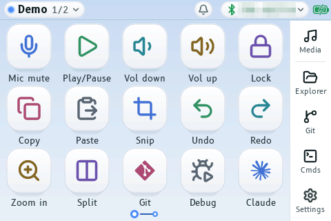
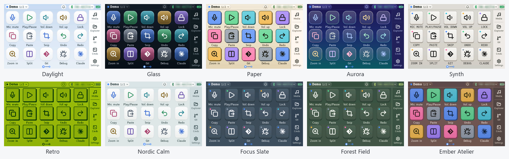
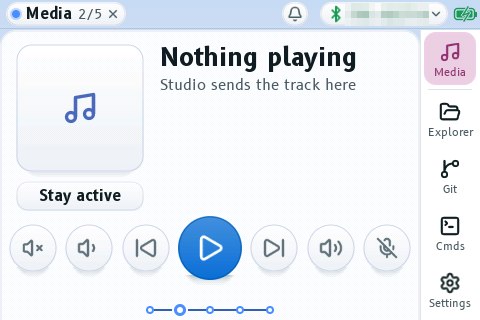
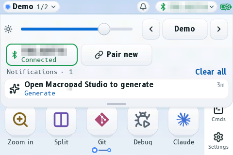
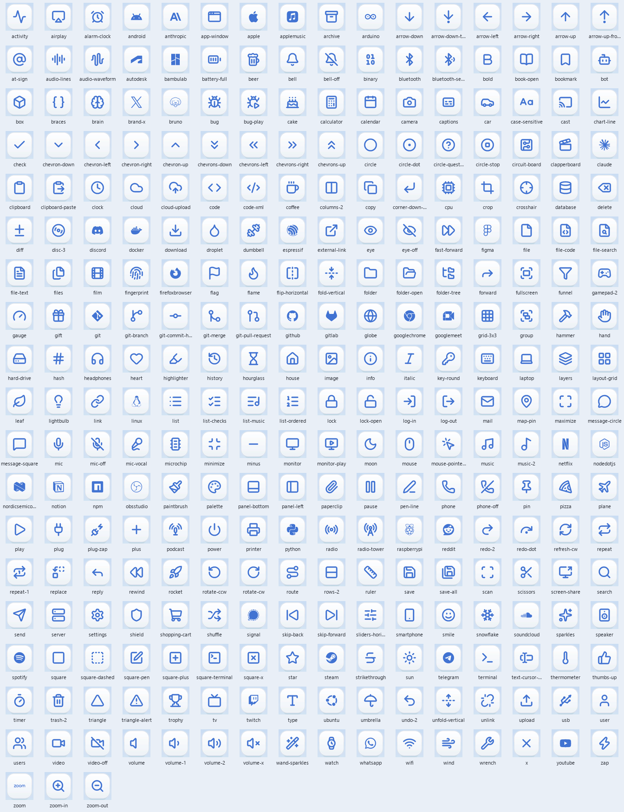

# ESP32 Touch Keypad

A Stream Deck–style BLE macropad on the LCDwiki 4.0" ESP32-32E board (E32R40T: ESP32-WROOM-32E, ST7796S 480×320, XPT2046 resistive touch), with Macropad Studio for Windows.

<p align="center"></p>

Ten device themes (Daylight by default, Glass, Paper, Aurora, Synth after the OP-1, Retro after the Game Boy, Nordic Calm, Focus Slate, Forest Field, Ember Atelier), keys with real icons (291 built in, each with its own animation), sixteen profile slots with a quick switch on the status band, this PC's notifications on a bell with a banner and a pull-down shade (brightness, profile, Bluetooth host), a host switch on the status band, a full-page media player fed from Windows (album art, live progress, tap to seek), a settings sheet (display, profiles, three Bluetooth hosts, LED patterns, key click, calibration, turn off until RESET), touch calibration on first boot, and every screen animating at 60 fps. On a battery it shows the charge, dims, turns its screen off and deep-sleeps after an idle time you choose; on USB it runs at full power with the screen always on, and shows charging.

| Path | What |
|---|---|
| `firmware/TouchKeypad/` | Arduino sketch: glass UI renderer (DMA, damage rects, 60 fps), gestures, calibration, profiles (schema v2), macro engine, NimBLE HID, LED patterns, line CLI |
| `firmware/DESIGN.md` | The device's design system (colour as state, B612, the ten themes) |
| `studio/` | Electron app: glass profile editor, media feed (track, art, seek), host bridge (F13–F24 → open / run / OBS), LED and display controls, firmware installer |
| `tools/kp.py` | Build, flash, screen capture, touch injection and uploads over USB |
| `tools/icons/`, `tools/fonts/`, `tools/gen_defaults.py` | Generate the key icons (Lucide, Simple Icons), the B612 fonts and the three default profiles |
| `tools/tests/` | Hardware tests for the firmware (pytest) |
| `tools/e2e/` | End to end on real Bluetooth and the real Windows media session: KpHelper (C#), `run_e2e.py`, `media_e2e.js` |
| `docs/PLAN.md` | Plan and design · `docs/PROTOCOL.md` the serial protocol · `docs/device/` the pixel-exact screen mock |

## Screens

Every picture here is the keypad's own screen, read back over USB (`kp.py shot`); the PC's Bluetooth name is blurred.

<p align="center"></p>

<p align="center">
  
  
</p>

Each key's icon acts out its key when the key fires, and a few play while the screen is idle (these are Studio's GIFs, built from the firmware's own frames):

<p align="center">
  
  
  
  
  
  
  
  
</p>

<details><summary>All 291 key icons</summary>



</details>

## Hardware

| Item | Value |
|---|---|
| Board | LCDwiki E32R40T (4.0" ESP32-32E display module) |
| Module | ESP32-WROOM-32E (ESP32-D0WD-V3): two Xtensa LX6 cores at 240 MHz, Wi-Fi, Bluetooth 4.2 + BLE |
| Memory | 520 KB SRAM, 4 MB flash, no PSRAM |
| Display | ST7796S, 4.0" TN, 480×320 (landscape), 4-wire SPI at 80 MHz, RGB565 |
| Touch | XPT2046 resistive, sharing the display's SPI bus |
| USB | USB-C through a CH340C serial bridge (flashing and the console) |
| Power | TP4054 Li-ion charger and a 1.25 mm battery connector, ME6217 LDO, battery voltage on IO34 |
| Audio | DAC on IO26 into an FM8002E amplifier, 1.25 mm speaker connector |
| Other | RGB LED, microSD slot on its own SPI bus, BOOT and RESET buttons |
| Draw | about 145 mA lit with icons moving, 38 mA with the screen off, on a 3.7 V cell |

The flash is split 1.8 MB for the app and 2 MB for profiles and tiles (LittleFS). Firmware 3.16.0 uses 1,757,087 of the app's 1,900,544 bytes; the full pin map is in `docs/PLAN.md` §3.

## Build and flash

Needs `arduino-cli` with `esp32:esp32@3.2.1`, LovyanGFX 1.2.x, NimBLE-Arduino 2.5.x and ArduinoJson 7.x. The board shows up as a CH340; `kp.py` finds it (or set `KP_PORT=COMx`).

```
python tools/kp.py flash             # KP_TEST build (build/fw): HID starts dry-run (reports logged, not sent)
python tools/kp.py flash --release   # normal build (build/fw-release)
python tools/kp.py cmd status
python tools/kp.py shot screen.png   # capture the LCD
python tools/kp.py touch 48 70       # tap cell 1;  hold / swipe too
```

On first boot the keypad asks for touch calibration: press the four targets, then the check point, then try the test pad. Hold BOOT for 2 s (or Settings → Device → Calibrate) to redo it.

## Studio

```
cd studio && npm start               # run from source
python tools/kp.py build --release && cd studio && npm run dist   # installer with the firmware bundled
```

Studio's editor shows the keypad's screen in its current theme; keys edit live (Ctrl+Z undoes, Ctrl+C / Ctrl+V copy keys, arrows move). It tells you when the keypad needs calibrating or has older firmware than Studio bundles, and its Device view installs that firmware over USB (profiles, pairings and calibration are kept). Without a keypad Studio only previews: profiles live on the keypad.

Studio follows the app in front: each mapped app (VS Code, Chrome, Slack, Terminal, Signal, Claude, File Explorer, Notepad++, Bruno, from `tools/profiles/app_profiles.py`) switches the keypad to its profile. Notifications from this PC (Slack, Teams, Outlook, any app) drop in at the top of the keypad and ring the bell on the status band; swipe down, or tap the bell, for the shade: brightness, the profile (< name >), the Bluetooth hosts to switch between, and the newest notifications (swipe one away). The host chip on the status band lists the saved hosts to switch to. Studio reads the Windows notification database (Settings › Notifications turns it off). Every key's icon acts out its key when the key fires: copy pulls a second sheet out of the first, save stamps a check into the disk, a bell rings, wifi lights its arcs from the dot, brand marks spin like a coin. While the screen is idle a few keys play at a time, and every 20 to 30 seconds a wave ripples across the keys from the top-left corner (`iconanim`, on by default; the Device view has the switch). The 291 animations are designed part by part in `tools/icons/anim_designs.js` and built into the firmware by `tools/icons/build_anims.js` (`npm run anims` in `tools/icons`). `studio/assets/icon-gifs/<theme>/` holds each one as a GIF in all ten themes, decoded from the same frames and drawn on that theme's real key (captured from the keypad by `tools/icons/capture_keys.py`) in its ink; Studio's key inspector shows the one for the keypad's theme. A key can also show a still image or play a GIF: in the editor choose **Choose a GIF or image…**; Studio decodes it (up to 16 frames at 72 × 72) and the keypad plays it, about 10 KB per frame. A folder key (its only action opens another page) is drawn as a stack of cards; VS Code's page 1 has a Git folder with Pull, Push, Commit, Stash and the rest. In the editor, **Ask Claude** (under the preview) organizes, creates and edits the open profile from a plain request ("put the Git keys in a folder"); each change is undoable and the keypad follows. For any other app, tap the profile name on the keypad, then **Generate**. Studio asks Claude (through Claude Code on this PC) for that app's shortcuts and loads the result; the next tap reuses it.

Studio connects over USB or, with no cable, over Bluetooth to a keypad paired with this PC (the keypad's console on a Nordic UART service, through `native/KpLink`). Everything works over Bluetooth except installing firmware, which needs the cable. The Device view shows USB or battery and the charge, and sets how long the keypad waits on battery before it sleeps.

## Tests, from fastest to fullest

```
cd studio && npm test                # 123 unit tests against a simulated keypad, a fake Bluetooth helper and a fake Claude Code
cd studio && npm run smoke           # Electron boots and draws the glass preview with all icons
python -m pytest tools/tests -v      # 164 tests on the board: keys, gestures, pixels, calibration, LED, player, sheet, every theme, 60 fps floors, power and turn off, quick switch, Generate, folders, GIF keys, moving icons, notifications and the shade
cd studio && npm run test:hw         # Studio's services against the board
node tools/e2e/media_e2e.js          # a silent Windows media session -> keypad player (title, album, cover) -> tap to seek -> back to Windows
python tools/e2e/run_e2e.py          # over BLE (reuses this PC's pairing): media keys read from Windows' HID stack, types, toggles, host action through Studio, Play/Pause
node tools/e2e/studio_e2e.js         # the installed Studio driven through its UI against the keypad, on USB
E2E_BLE=1 node tools/e2e/studio_e2e.js   # the same over Bluetooth only (USB hidden from Studio)
```

The BLE E2E types only into the window it opens and keeps focused, and presses Play/Pause only while its own silent media session is the one Windows routes media keys to. When this PC is already paired it reuses that pairing and leaves it in place; `--fresh-pairing` clears the bonds and pairs again. Both runs save the keypad's settings first and put them back after. While the PC is locked, the lock screen takes every keystroke, so those tests report SKIP; the media-key check reads Windows' HID stack directly and runs either way.

## Hardware notes found in bring-up

- **Screen readback** needs `SPI_MISO_DELAY_MODE = 2` on HSPI, otherwise every pixel reads one bit shifted (`display.cpp`). The panel runs clean at 80 MHz.
- **Serial uploads** collect in RAM and touch flash only after `###END###`. In this core the UART ISR isn't in IRAM, so a flash erase mid-stream drops RX bytes.
- **DTR and RTS** must be released after opening the port: DTR alone holds IO0 low, which reads as a BOOT hold.
- **NimBLE** asks `onPassKeyDisplay()` only while the static passkey is the default. `bleForget` stops advertising first, because the resolving list can't change while advertising.
- **USB or battery:** the board has no VBUS pin. The CH340's TX line idles high only while USB powers the chip, so RX (IO3) tells them apart, but only sampled with a pull-down: unpowered, the chip lets go of the line and the UART's own pull-up reads high.
- **Deep sleep** leaves the GPIOs floating: the backlight (IO27), amp enable (IO4), LED and chip-select pins are held through it with `gpio_hold_en`, and released first thing at boot, or the LCD ignores its init after a wake.
- **Bluetooth power:** this core has no power management (`CONFIG_PM_ENABLE` off) and the ESP32 needs a 32 kHz crystal on IO32/33 to keep a BLE link in light sleep (IO33 is the touch CS), so a connected keypad can only let the radio nap between connection events. Windows gives HID 15 ms with a peripheral latency of 30 on its own.
- **Windows GATT:** open the console service shared and dispose it on exit. A service left to the finalizer stays held, and the next connection gets AccessDenied. Read characteristics and descriptors uncached: after a firmware update, the cached CCCD handle answers "write not permitted".
- **Heap:** about 114 KB free with NimBLE, the double DMA buffers and the album-art buffer. The album cover (128×128, 32 KB) is decoded into two 16 KB halves, which fit where one 32 KB block often doesn't once the heap has split; when even they find no room, the keypad drops the decoded tiles and the inflated icon animations (both come back from flash) and tries again. Studio checks each profile it reads against the file's size from `ls`, so a reply that lost bytes on the way is refused instead of autosaved.
- **Flash:** the key icons' 4-bit masks are run-length coded (188 KB to 96 KB) and unpacked per draw into a 648-byte buffer per core; the animations are deflated per icon and inflated by the ESP32's ROM `tinfl` while a key plays them.
- **Bluetooth console:** after a quiet spell the link can sleep through 30 connection events (0.45 s) before the notify queue drains, so a chunk of console output waits up to 1.5 s for room; giving up sooner left holes in replies (3.15.1).
